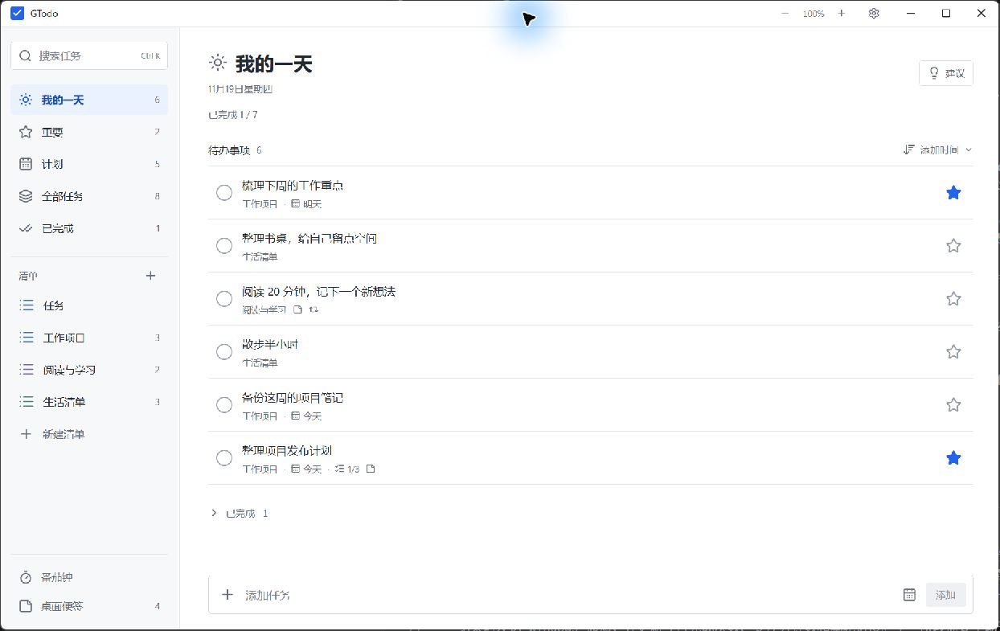
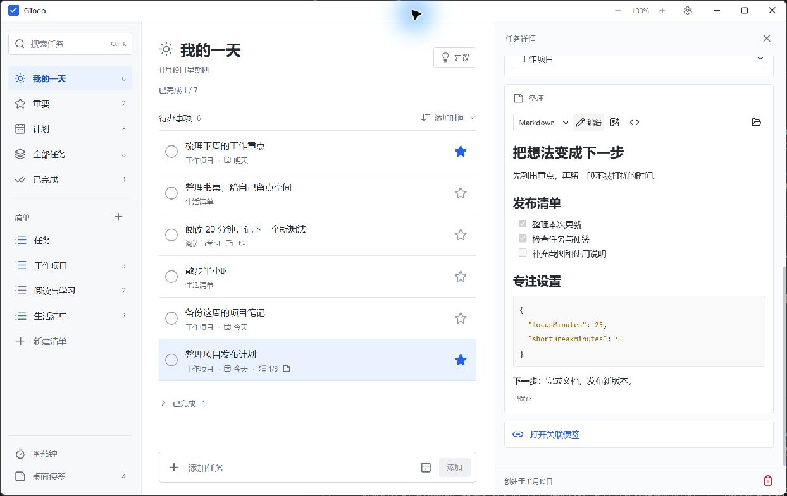
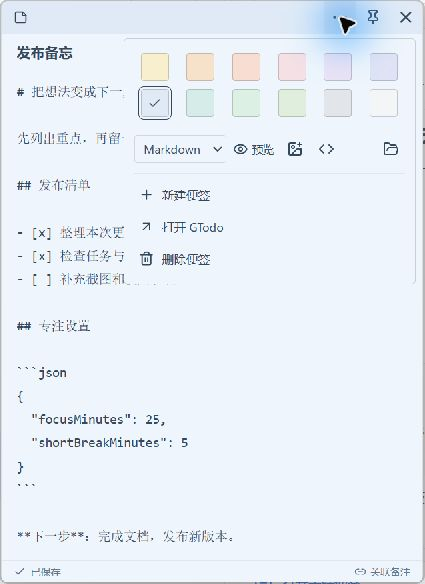

  
  <h1>GTodo</h1>
  
<strong>待办、便签与专注，放在一起。</strong>

  
Windows x64 · v0.1.1 · 本地保存

  

    <a href="https://github.com/num73/gtodo/releases">下载 Windows 版</a> ·
    <a href="help.md">使用帮助</a> ·
    <a href="https://github.com/num73/gtodo/issues">反馈问题</a>
  

GTodo 是一款简洁的 Windows 桌面待办应用。用清单安排今天，把灵感留在便签上，再开一轮番茄钟，专心完成眼前的一件事。

## 日常需要的功能，都在手边

| 功能 | 用法 |
| --- | --- |
| **任务与清单** | 我的一天、重要、计划和自定义清单；支持子步骤、日期、提醒、重复任务及右键删除、撤销。 |
| **Markdown 备注** | 纯文本与 Markdown 自由选择，支持图片、表格、代码高亮和预览，也能用外部编辑器修改。 |
| **桌面便签** | 12 种配色，可移动、调整大小和置顶；手动关联任务后，备注与便签双向更新。 |
| **独立番茄钟** | 专注、短休息和长休息；关联任务、查看今日统计，收起窗口后继续计时。 |
| **本地数据与网盘目录** | 离线也能记录。选择 OneDrive、坚果云等客户端的本地同步文件夹，由网盘客户端同步数据。 |
| **自适应界面** | 拖动分隔线调整布局，支持 60%～200% 缩放，窄窗口下自动切换展示方式。 |

有日期的任务还可单向同步到**经典 Outlook** 日历。接入条件与同步范围见[使用帮助](help.md#outlook-日历同步)。

## 备注，也可以是一份 Markdown 文档

在任务旁边写计划、贴图片、保存代码。需要排版时切换到 Markdown，点击预览即可查看效果。

正文保存为真实的 `.md` 或 `.txt` 文件，图片保存在文档旁的 `assets` 文件夹。用 VS Code、记事本等外部编辑后，GTodo 会自动读回修改。

## 把便签和番茄钟留在桌面

便签随手记，番茄钟专心做。两个窗口都支持移动、调整大小和置顶，不必一直打开主界面。

| 桌面便签 | 独立番茄钟 |
| :---: | :---: |
|  |  |
| 颜色和编辑工具收在“…”菜单里，把更多空间留给正文。 | 为当前任务留出一段专注时间，随时暂停或继续。 |

任务与便签需要**手动确认关联**，之后修改任一方都会更新另一方。删除任务或便签，只解除关联，另一方内容仍保留。

## 开始使用

1. 前往 [Releases](https://github.com/num73/gtodo/releases) 下载 Windows x64 **ZIP 版**。
2. 完整解压到固定文件夹，运行其中的 `GTodo.exe`。请保留整个文件夹，也可为 EXE 创建快捷方式。
3. 添加第一条任务。需要多设备同步时，在设置中选择网盘客户端的本地同步文件夹。

同时提供单文件 EXE 版；它每次启动会先解压运行环境，日常使用推荐 ZIP 版。当前发布包尚未代码签名，Windows 首次运行时可能显示发布者或 SmartScreen 提示。

升级时先完全退出旧版，原有本机数据会继续使用。文件存储、外部编辑、日历同步、快捷键和备份说明均在 **[使用帮助](help.md)** 中。

## 关于项目

- 作者邮箱：[xlnum73@outlook.com](mailto:xlnum73@outlook.com)
- 问题与建议：[GitHub Issues](https://github.com/num73/gtodo/issues)
- 开发与构建：[开发说明](help.md#开发与构建)

GTodo 是独立项目，不隶属于 Microsoft。页面截图使用演示数据。
