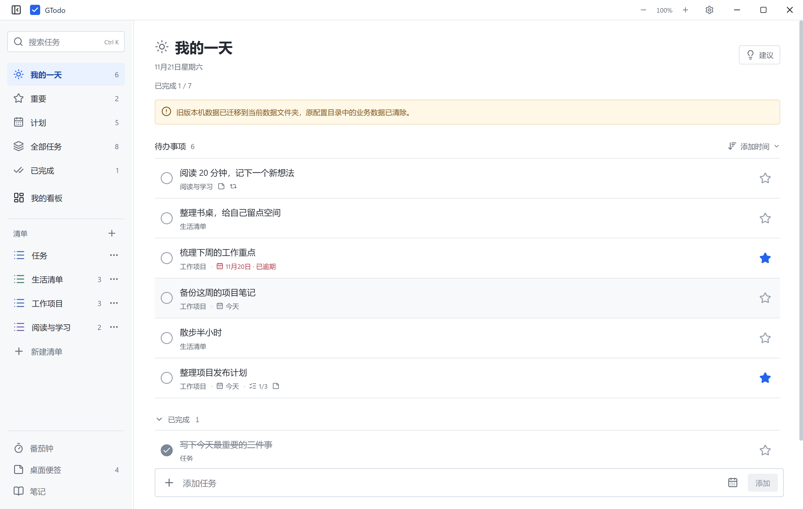
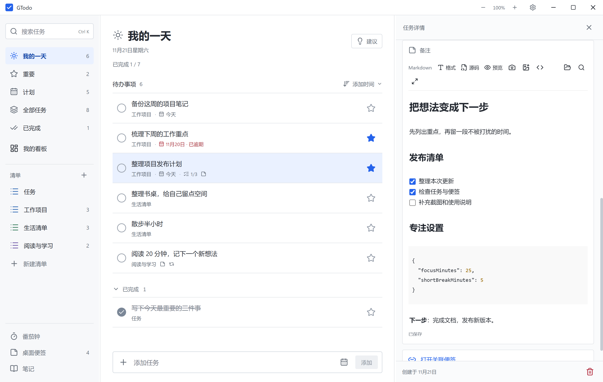
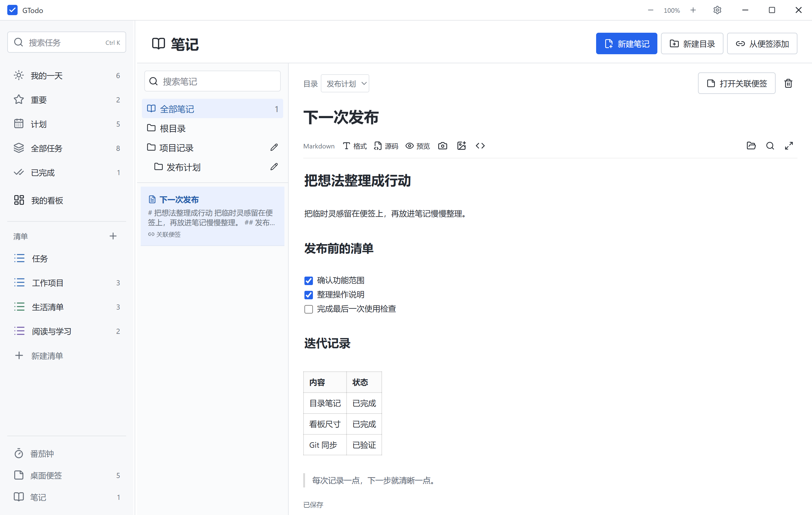
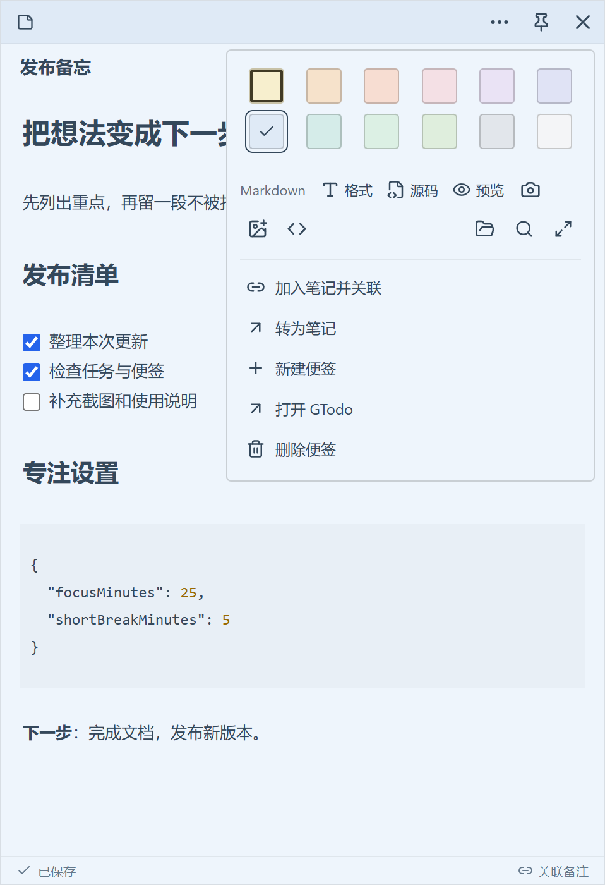

  
  <h1>GTodo</h1>
  
<strong>待办、便签与专注，放在一起。</strong>

  
Windows x64 · v0.2.1 · 本地保存

  

    <a href="https://github.com/num73/gtodo/releases">下载 Windows 版</a> ·
    <a href="help.md">使用帮助</a> ·
    <a href="CHANGELOG.md">更新日志</a> ·
    <a href="https://github.com/num73/gtodo/issues">反馈问题</a>
  

GTodo 是一款简洁的 Windows 桌面待办应用。用清单安排今天，把灵感留在便签上，再开一轮番茄钟，专心完成眼前的一件事。

## 日常需要的功能，都在手边

| 功能 | 用法 |
| --- | --- |
| **任务与清单** | 我的一天、重要、计划和自定义清单；名称、备注与步骤自动保存，支持日期、提醒与重复任务，任务和步骤删除后可撤销。 |
| **Markdown 编辑** | 笔记、备注与便签在同一编辑区边写边预览；提供常用格式、表格和链接插入、查找替换、展开编辑、截图和代码高亮，也可切换源码。 |
| **目录笔记** | 在“桌面便签”下方进入笔记，按多层目录整理、搜索和移动。可关联便签或将便签转为笔记；关联两边共用正文，全部移除后才进入回收站。 |
| **桌面便签** | 12 种配色，可移动、调整大小和置顶；手动关联任务后，备注与便签双向更新。 |
| **自由看板** | 将任务、便签、标语和图片自由摆放；文字贴纸无顶部横栏，提供 8 种背景配色与自定义颜色。画布提供 5 种尺寸预设与自定义宽高，可独立全屏、设置背景图片，布局随数据保存与同步。 |
| **回收站** | 在设置中查看和恢复已删除的记录，确认后永久清理正文、附件与残留文件。 |
| **独立番茄钟** | 专注、短休息和长休息；界面随窗口尺寸缩放、横向分栏，支持关联任务和今日统计，收起后继续计时。 |
| **本地数据与网盘目录** | 离线也能记录。导入、导出备份及切换目录前等待编辑保存；可选择 OneDrive、坚果云等客户端的本地同步文件夹。 |
| **Git 同步** | 在设置中初始化当前数据目录，配置远程仓库与提交身份；开启后从标题栏执行 Add、Commit、Pull、Push，操作前等待编辑保存。 |
| **自适应界面** | 拖动分隔线调整布局，支持 60%～200% 缩放；空间足够时自动显示左侧导航，窗口按钮随最大化或还原状态变化。 |
| **个人偏好** | 在分类设置中选择启动页面、关闭窗口的行为、启动恢复、提醒开关、默认便签颜色和看板文字样式，也可统一调整番茄钟时长与重置分栏。 |

有日期的任务还可单向同步到**经典 Outlook** 日历。接入条件与同步范围见[使用帮助](help.md#outlook-日历同步)。

## 备注，也可以是一份 Markdown 文档

在任务旁边写计划、贴图片、保存代码。默认直接在排版中编辑，标题、强调、列表和代码随输入实时显示；点击图片或表格可编辑对应的 Markdown。需要时可切换源码，或进入只读预览。

“格式”工具可插入标题、列表、表格和链接；`Ctrl+F` / `Ctrl+H` 在当前文档中查找替换，右侧展开按钮可将编辑区铺满窗口。独立的“笔记”页面支持目录管理，便签中的想法也能直接转入笔记继续整理。

正文统一保存为真实的 `.md` 文件，普通文字也能直接记录，旧文本按 Markdown 原样读取。图片保存在文档旁的 `assets` 文件夹，支持框选截图、粘贴和拖入。用 VS Code、记事本等外部编辑后，GTodo 会自动读回修改。

## 用目录整理笔记

为项目建立目录，把随手记的便签转入笔记，或让一篇笔记同时显示在桌面上。关联两边共用内容，删除一边后另一边仍可继续使用。

## 把便签和番茄钟留在桌面

便签随手记，番茄钟专心做。两个窗口都支持移动、调整大小和置顶，不必一直打开主界面。

| 桌面便签 | 独立番茄钟 |
| :---: | :---: |
|  |  |
| 颜色和编辑工具收在“…”菜单里，把更多空间留给正文。 | 为当前任务留出一段专注时间，随时暂停或继续。 |

任务与便签需要**手动确认关联**，之后修改任一方都会更新另一方。删除任务或完整删除便签记录后，另一方内容仍保留。笔记与便签共用一条记录；只删除一个入口时，另一边仍保留，两个入口都删除才进入回收站。

## 开始使用

1. 前往 [Releases](https://github.com/num73/gtodo/releases) 下载 Windows x64 **ZIP 版**。
2. 完整解压到固定文件夹，运行其中的 `GTodo.exe`。请保留整个文件夹，也可为 EXE 创建快捷方式。
3. 添加第一条任务。需要多设备同步时，在设置中选择网盘客户端的本地同步文件夹。

同时提供单文件 EXE 版；它每次启动会先解压运行环境，日常使用推荐 ZIP 版。当前发布包尚未代码签名，Windows 首次运行时可能显示发布者或 SmartScreen 提示。

需要固定到任务栏时，先运行 GTodo，再右键任务栏中正在运行的图标选择“固定到任务栏”。旧入口出现重复图标时，先取消旧入口的固定，再按此方式重新固定；详见[任务栏固定](help.md#固定到任务栏)。

升级时先完全退出旧版，原有本机数据会继续使用。文件存储、外部编辑、日历同步、快捷键和备份说明均在 **[使用帮助](help.md)** 中。

## 关于项目

- 作者邮箱：[xlnum73@outlook.com](mailto:xlnum73@outlook.com)
- 问题与建议：[GitHub Issues](https://github.com/num73/gtodo/issues)
- 开发与构建：[开发说明](help.md#开发与构建)

GTodo 是独立项目，不隶属于 Microsoft。页面截图使用演示数据，点击图片可查看原分辨率的无损 PNG。
