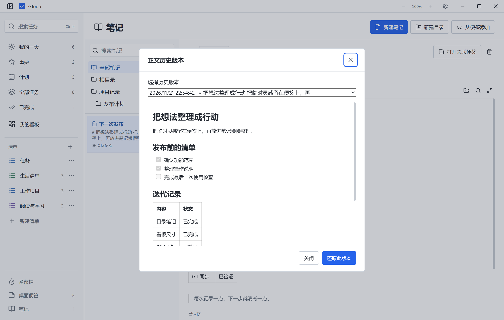
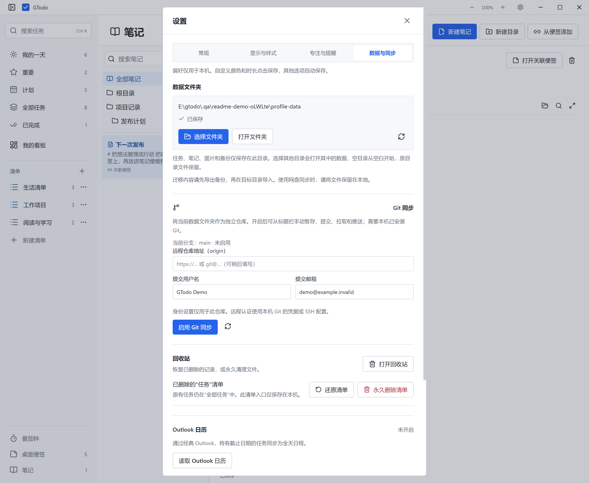
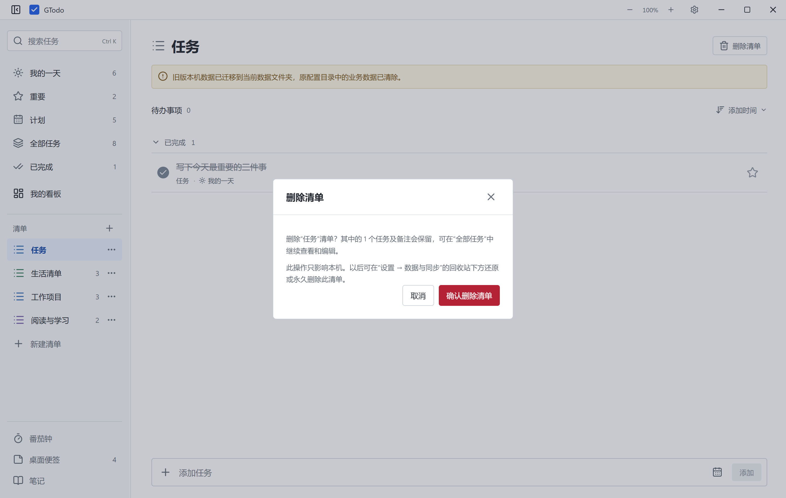
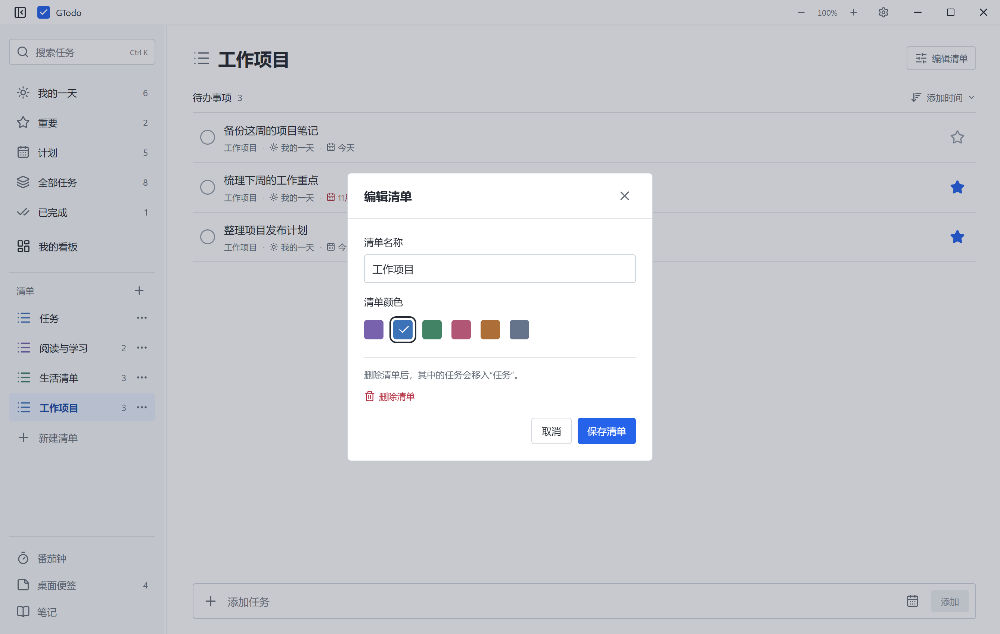

# GTodo v0.2.1

参考 Microsoft To Do 操作方式制作的 Windows 桌面待办应用。支持目录笔记、桌面便签、Markdown 编辑、自由看板、本地数据文件夹与 Git 手动同步。

版本变化见[更新日志](CHANGELOG.md)。

## 启动

推荐将 `release/GTodo-v0.2.1-Windows-x64.zip` 完整解压到固定文件夹，再打开其中的 `GTodo.exe`；以后直接打开该文件，也可为它创建快捷方式。保留整个文件夹，不能只复制其中的 EXE。仓库中的 `release/win-unpacked/GTodo.exe` 也可直接运行。

`release/GTodo-v0.2.1-Windows-x64.exe` 是单文件便携启动包，**每次运行都会先解压 Electron 运行环境**，首次冷启动通常更明显；ZIP 版只需手动解压一次。两种版本使用相同的本机数据位置，切换前通过“设置 → 退出 GTodo”完全退出旧进程。这些都是未签名的本地构建。

主窗口从所选数据目录读取本设备索引，随后在后台合并同一目录中的其他设备索引与外部文档，再恢复便签和番茄钟。业务数据不另存到 AppData。退出前等待编辑保存；Markdown 实时编辑器、只读预览与代码语言高亮按需加载。

已修复 Outlook 日历创建时“GTodoCalendar 属性不支持此操作”的错误：新建日历使用标准描述字段保存归属标记，兼容旧版标记；已有未标记日历保持原样。日程本身的归属和任务 ID 检查继续生效。

使用白色、浅灰和蓝色强调的扁平界面，任务以分隔线排列。主界面、设置与便签统一为小圆角控件，移除渐变、阴影、装饰插画与宣传文案，保留操作所需的说明。

已移除 OneDrive / WebDAV 登录、OAuth、密码管理和网络同步接口。不需要注册 Microsoft 应用或填写 Client ID。旧版的本地任务会自动保留，旧登录凭据不会被读取。

## 固定到任务栏

1. 如果已有重复图标，先右键原有 GTodo 固定入口，选择“从任务栏取消固定”，再通过“设置 → 退出 GTodo”完全退出旧版。
2. 运行新版 ZIP 中的 `GTodo.exe`，或新版单文件便携 EXE。
3. 右键任务栏中**正在运行的 GTodo 图标**，选择“固定到任务栏”。以后从这个入口启动。

运行窗口会提供一致的应用标识、图标和启动命令。便携版的入口指向外层 EXE，避免固定到每次启动都会变化、退出时会删除的临时解压程序。旧版本或直接固定文件产生的入口不会自动更新，需要按上面的步骤重新固定一次；GTodo 不会擅自改动已有任务栏固定项。

固定后请保持 EXE 和 ZIP 解压目录的位置稳定。移动、重命名或升级到另一个目录后，重新固定新位置的运行图标。

## 设置与个人偏好

点击主窗口右上角的齿轮，设置按四类排列：

| 类别 | 可调整的内容 |
| --- | --- |
| 常规 | 启动默认页面、关闭主窗口时的行为、启动时恢复便签和番茄钟窗口 |
| 显示与样式 | 界面缩放、重置分栏宽度、默认展开已完成任务、新便签颜色、看板文字与标语的默认背景、文字颜色和字号 |
| 专注与提醒 | 任务提醒通知、番茄钟结束提醒、专注和休息时长、长休息间隔 |
| 数据与同步 | 数据文件夹、Git 初始化与配置、回收站及已删除“任务”清单的还原/永久删除、Outlook 日历、ZIP / JSON 备份 |

自定义颜色、番茄钟时长和 Git 配置需要点击保存，其他偏好自动保存，重启后生效或保留。应用偏好只用于当前电脑，不随任务文件夹同步，也不包含在任务 JSON 备份中；Git 仓库配置位于数据目录的 `.git` 中。

- 启动页面默认“我的一天”，可改为“我的看板”等常用页面；修改后不会跳离当前页面，下次启动生效。
- 关闭主窗口默认保留原有规则：有便签或番茄钟窗口、正在计时或暂停的番茄钟、已开启的日历同步时留在后台，否则退出。也可选择“始终留在后台”或“退出 GTodo”；退出前保存内容并暂停计时，保存失败会保留窗口。后台状态可从系统托盘重新打开。
- 启动恢复默认开启；关闭恢复不会删除内容或立即关闭现有窗口。便签的位置、大小和置顶记录保留，可从“桌面便签”手动打开。恢复番茄钟窗口不会自动开始计时。
- 默认展开已完成任务只控制普通任务列表；搜索与“已完成”页面始终展示完成记录。列表中的展开按钮仍可临时调整。
- 新便签默认黄色，适用于桌面、看板及任务中新建的便签。看板文字默认浅黄背景、深色文字、28 号字，提供 8 种预设背景与自定义颜色；这些默认样式只作用于以后新建的内容，原有内容保持原样。
- 任务与番茄钟通知默认开启，可分别关闭；不会删除任务的提醒时间或停止记录番茄钟完成次数。通知需要应用保持运行且 Windows 允许通知。在同一次运行中，关闭期间已到时的任务提醒不会在重新开启后集中补发。
- 番茄钟时长也可在“专注与提醒”中修改，点击“保存时长”；计时中或暂停时需先在番茄钟窗口重置。切换设置分类和定时刷新不会覆盖正在输入的时长。

## 番茄钟

从左侧清单栏的“番茄钟”打开独立窗口，也可以在任务详情中点击“专注此任务”。顶部标题栏仅保留设置入口，不再显示番茄钟；左侧不再显示重复的设置按钮。

- 默认专注 25 分钟、短休息 5 分钟，每完成 4 次专注安排 15 分钟长休息。可单独选择模式，调整时长和长休息间隔。
- 支持开始、暂停、继续和重置。计时中或暂停时锁定模式、关联任务和时长，重置后可更改；重置不计入完成次数。
- 番茄钟是可移动、缩放和置顶的独立窗口，最小 280 × 320；窗口尺寸、位置、置顶和展开状态只保存在本机，默认下次启动会恢复，可在“设置 → 常规”中关闭恢复。
- 拖动窗口边缘时，计时数字、文字、按钮和间距会随可用宽高调整；宽而矮的窗口自动切换左右布局。小窗口保留计时与主要操作，时长设置展开后可滚动；调整大小不会重置计时或丢失未保存的时长。
- 左侧入口和托盘提示显示剩余时间。收起番茄钟窗口、最小化或关闭主窗口留在后台后继续计时；若设置为关闭时退出，则保存并暂停。托盘菜单可暂停、继续和重新打开番茄钟。番茄钟右上角的箭头可返回主窗口。
- 结束时发送 Windows 通知，并更新今日完成次数、专注分钟数和本轮进度。下一阶段需要手动开始，避免无人操作时连续累计番茄；系统关闭通知或开启勿扰时，仍可在番茄钟面板查看完成状态。
- 可以关联一个未完成任务，专注结束不会自动完成该任务。已完成或删除的任务在下一次开始时解除关联。
- 通过“退出 GTodo”退出应用或电脑休眠时暂停，剩余时间会保存，下次打开可继续。计时以主进程保存的结束时间为准，避免页面后台节流造成停滞。
- 时长、计时状态和最近 366 天的统计保存在本机应用数据目录的 `pomodoro.json`，上一版保存在 `.bak`。不随网盘同步，也不包含在任务 JSON 导出中。

## Outlook 日历同步

在 **设置 → 数据与同步 → Outlook 日历 → 读取 Outlook 日历** 中选择账户日历，再点击“开启同步”。需要 Windows 上已安装并配置账户的**经典 Outlook**。首次升级默认不开启，不会自动写入日历。

- GTodo 在所选账户的日历下创建独立的 `GTodo` 子日历；同名但不属于本应用的日历会保留，新建的日历会自动加序号。
- 有截止日期的任务同步为当地日期的全天日程，显示为空闲，不占用忙碌时间。标题、备注、子步骤、重要和完成状态一起更新；桌面便签不进入日历。
- 任务完成后，日程保留并加 `✓` 标记；取消完成会恢复。删除任务或清除截止日期会移除对应的 GTodo 日程。
- 采用单向同步。在 Outlook 中修改 GTodo 日程，会在下一次同步时按 GTodo 任务还原。不会读取 Outlook 事件来创建或改写任务。
- 重复任务在完成后生成下一次任务并同步，日历中不另外建立重复系列。提醒继续由 GTodo 发送，避免全天日程在午夜重复提醒。
- 应用运行时，任务或数据目录变化会自动触发同步，并每分钟检查一次；设置中也可“立即同步”。失败会显示原因并重试，本地任务仍正常保存。
- 只处理带有 GTodo 标记且任务 ID 对应的日程；非 GTodo 日程、其他工作区的未知任务、已改为会议的项目和重复 ID 项目不会被自动删除。
- “停止同步”和更换目标日历会保留已写入的旧日程。同一份任务请只在一台电脑开启 Outlook 同步，其他电脑仍可通过网盘目录合并任务。

本功能写入经典 Outlook 的本地日历，**上次更新**指已写入 Outlook，不代表已经上传到云端。Outlook 负责账户的云端传输。同一 Outlook.com / Microsoft 365 等云端账户的新 Outlook 或其他客户端可以查看相应日历；本地 PST 日历不会自动上传。仅安装新版 Outlook 时无法直接使用本地接口，也不会把任务显示到 Windows 11 原生任务栏的日期弹窗中。

默认设置下，同步开启后关闭主窗口会收起到托盘，继续同步和提醒；若在常规设置中改为关闭时退出，则一同停止。也可随时使用“设置 → 退出 GTodo”或托盘菜单完全退出。日历目标和开启状态只保存在本机设置中，不随网盘共享，也不收集账户密码。

## 桌面便签

在左下角打开“桌面便签”，点击“新建便签”；也可以在主界面按 `Ctrl + Shift + N`，或使用系统托盘菜单新建。

- 支持多张独立便签，拖动顶部标题栏的空白处或便签图标移动位置，拖动边缘调整大小；最小 260 × 240。便签名称在正文上方单独编辑，避免拖动时误触。
- 标题与正文自动保存，也可以按 `Ctrl + S`。收起或退出时会等待最后的编辑保存完成；保存失败会保留窗口与文字。
- 标题栏“…”菜单包含颜色、实时/源码编辑、只读预览、截图、插入图片、插入代码和文件位置；默认收起，不占正文空间。支持黄色、橙色、珊瑚色、粉色、紫色、靛蓝、蓝色、青色、薄荷色、绿色、灰色和白色 12 种配色，色板分两行显示，小窗口也能完整选择。右上角图钉可置顶，再点一次取消。
- 便签右上角的 × 表示“收起”，不会删除内容；可以从便签管理中重新打开。“…”菜单中可新建或删除便签，管理界面删除后可撤销。卡片底部及“…”菜单中的加入/打开关联笔记、转为笔记与删除按钮使用同排图标，悬停可查看操作名称。
- 默认关闭 GTodo 主窗口时，桌面上的便签继续显示；如果选择关闭时退出，则保存内容并关闭所有窗口。通过“…”菜单的“打开 GTodo”或系统托盘图标可重新打开后台主窗口。
- 完全退出也可使用“设置 → 退出 GTodo”或托盘菜单的“退出 GTodo”。默认下次启动恢复未收起的便签及其位置、大小和置顶状态，可在“设置 → 常规”中关闭恢复。
- 任务默认不关联便签。在任务详情点击“创建关联便签”，再点击“确认创建”后才建立关联；之后按钮变为“打开关联便签”，重复打开不会创建多张便签。已有独立便签不会自动关联。
- 关联后 Markdown 正文和图片双向同步；便签名称、颜色与任务标题等属性各自独立。收起便签不解除关联。
- 完整删除便签记录会解除任务关联并保留任务备注；删除任务会解除关联并保留便签。若便签还关联笔记，只移除便签入口时任务与笔记仍共用正文。删除前先保存编辑，保存失败则取消删除。完整删除后撤销不重建任务关联；重复任务的新一次任务也默认不关联便签。
- 窗口加载失败时自动重试一次；仍失败会收起空白窗口，保留已保存的便签，可在“桌面便签”中重新打开。单张便签恢复失败不再阻止整个应用启动。

便签内容与颜色保存在所选的数据文件夹中，参与文件合并、导出和导入备份。窗口位置、尺寸、是否展开和置顶状态只保存在当前电脑。1.0 / 1.1 的任务数据和备份可以直接读取。

使用新增配色时，同步该数据文件夹的其他电脑也需更新到支持 12 色的构建；旧构建无法读取包含新增颜色的快照。

便签属于 GTodo 的独立桌面窗口；程序完全退出后不会继续显示。未启用置顶时，便签可能被其他窗口遮挡。当前没有开机自启。

加载错误和启动阶段耗时记录在本机 `%APPDATA%\GTodo\diagnostics.log`，达到 512 KB 后轮换并保留上一份，不记录便签正文。`startup-local-ready` 记录 Electron 进程启动至主窗口请求本机数据的时间，`startup-folder-ready` 记录首次文件夹扫描的完成时间与耗时；这些时间不包含便携启动器的解压。便携包每次启动使用独立的临时解压目录，避免重复启动时清理另一实例的资源。当前 electron-builder 26.18.0 的代码使用 `portable.unpackDirName: true` 启用此行为。

## 笔记与目录

左侧“桌面便签”下方的“笔记”进入独立笔记页面。可在“设置 → 常规”中将它设为启动页面。

- 点击“新建目录”可建立多层目录，当前选中的目录作为上级。目录旁的编辑按钮可改名或调整上级；不能移动到自身或子目录中。
- 选中目录后“新建笔记”，标题与 Markdown 正文自动保存。顶部“目录”可移动当前笔记；左侧支持按标题及正文搜索、查看全部或根目录。窄窗口用“笔记列表”返回目录与列表。
- 右键笔记可打开、重命名、移动到目录、关联便签或删除；右键目录可新建笔记、子目录以及重命名、移动和删除目录。`Shift+F10` 也可打开菜单，方向键选择，Esc 关闭并回到原项目。删除笔记需确认且支持撤销；删除目录保留其中笔记与子目录。
- 删除确认窗口显示具体笔记名称：未关联便签的笔记移入“设置 → 数据与同步 → 回收站”；有关联便签时，只从笔记中移除，桌面便签及正文保留。默认聚焦“取消”，点击红色“删除笔记”按钮才会删除。

  [查看删除笔记确认窗口](docs/images/note-delete-dialog.png)
- 删除目录只移除分类，里面的笔记和子目录保留在根目录；目录可撤销删除或从回收站恢复。
- 在笔记中点击“关联便签”即可显示到桌面；“从便签添加”可选已有便签。便签管理和便签的“…”菜单也提供“加入笔记并关联”“转为笔记”。转换会收起桌面窗口并直接打开该笔记，内容和附件保留。
- 关联的笔记与便签使用**同一个记录、标题、Markdown 正文及图片**。两边修改会同步；删除一边仅移除这一入口，另一边仍可继续编辑。两边都删除后才进入回收站，再按原有确认步骤永久删除。撤销操作仅恢复对应入口，回收站恢复会恢复此前移除的两个入口。
- 目录层级保存在数据快照中，不会重命名磁盘上的 Markdown 文件夹。笔记沿用 `documents/notes/note-<ID>/note.md`，转换或关联不会复制出第二份正文；已关联任务时仍共用任务的文档位置。

## 我的看板

从左侧“我的看板”进入自由画布。v0.2.1 起提供看板功能，可自由摆放任务、便签、文字和图片，并设置自己的背景。

“尺寸”提供紧凑 1280 × 720、标准 1600 × 1000、宽屏 1920 × 1080、大画布 2560 × 1440、竖向 1080 × 1920，也可直接填写宽高。宽度范围 480～12000、高度范围 320～12000 像素。新看板默认标准尺寸；旧看板保持原范围，可自行缩小。缩小时超出边缘的贴纸会移回画布内，内容保留，但可能重叠；尺寸随数据保存、备份和同步。

- 上方“任务”“便签”可搜索并贴上已有内容，也可直接新建。新任务同时进入“任务”清单（该清单已删除时可在“全部任务”中查看），新便签同时保存在“桌面便签”中；已有贴纸会定位到原位置，避免重复添加。
- 任务与便签贴纸显示原内容的最新状态。点击右上角箭头打开原任务或便签；看板上勾选任务也会更新任务清单。贴到同一看板不会建立任务与便签之间的正文关联。
- “文字 / 标语”贴纸没有顶部横栏和常驻边框，选中时显示操作轮廓。直接拖动文字区域移动，双击或按 Enter 编辑；提供浅黄、浅粉、浅蓝、薄荷绿、淡紫、杏橙、浅灰、白色 8 种背景预设，也可自定义背景色、文字颜色、字号和对齐方式。点击保存后生效，取消不改变原样式。
- 任务、便签和图片贴纸仍通过顶部移动；所有贴纸均可拖动右下角调整大小，文字贴纸的调整手柄在悬停或选中时显示。到达画布边缘后限制尺寸，不会挪动贴纸原位置。选中贴纸后可打开、调整样式、置顶、置底或移除；图片还可选择完整显示或填满卡片。键盘方向键移动 10 像素，按住 Shift 移动 50 像素；聚焦右下角手柄时，方向键调整大小。移动和大小自动保存，保存失败会保留位置并显示重试入口。
- “图片”支持 PNG、JPEG、GIF、WebP，单张不超过 10 MB。也可把图片文件拖到看板上，或聚焦看板后粘贴剪贴板中的图片；每次最多添加 12 张。
- “背景”中选择自己的图片，预览后点击“应用背景”；取消不会改变原背景。可选择铺满或完整显示、背景颜色和调暗程度。背景图片固定在当前可视区域。
- 拖动空白处或使用滚动条浏览画布。底部缩放只影响看板，“查看全部”可找回所有贴纸；缩放与浏览位置只保存在当前电脑。
- 点击看板右上角“全屏”可让看板独占屏幕，隐藏应用标题栏和清单导航，同时保留编辑、背景、缩放和撤销操作。按 Esc 或点击“退出全屏”返回原窗口；打开原任务、便签或使用应用搜索时也会先退出看板全屏。全屏切换不会重建贴纸或重置看板缩放。
- 从看板移除贴纸后可撤销，也可在设置的回收站恢复；原任务和便签不会被删除。原内容被删除时，贴纸显示缺失提示，恢复原内容后重新显示。
- 贴纸内容、位置、大小、样式和背景参与本地保存、数据文件夹合并及 ZIP / JSON 备份。看板图片与正文图片共用数据文件夹的 `assets`，使用内容校验命名；读取兼容旧 `board/assets`。移动原图片文件不会影响已导入的图片。同步目录的其他电脑应使用本次构建。

## Markdown 与外部编辑

笔记、任务备注与桌面便签统一使用 Markdown，默认在同一个编辑区边写边预览，无需反复切换编辑和预览。普通文字直接输入即可；旧文本按 Markdown 原样读取，不需要手动转换。

- 支持标题、粗体、斜体、删除线、列表、引用、勾选项、表格、链接、图片和代码块。正在编辑的语法显示标记，移开光标后恢复排版；原始 Markdown 不会被排版过程重新改写。
- 点击勾选框可切换完成状态。点击图片或表格会显示对应的 Markdown 源码，修改后移开光标即可重新显示；表格当前通过源码编辑单元格内容。按住 `Ctrl` 单击链接可打开网页。
- 工具栏的“源码”可查看和修改整篇 Markdown，再点击“实时”返回排版编辑；本机会记住下次打开编辑器时使用的模式。便签的工具栏位于标题栏“…”菜单。
- “格式”作用于当前选择或所在行，支持三级标题、粗体、斜体、删除线、行内代码、列表、勾选清单和引用，也可插入表格模板或网页链接。
- 文档中按 `Ctrl+F` / `Ctrl+H` 或点击放大镜，打开查找替换；支持逐项替换、全部替换、大小写、完整单词和正则表达式。焦点在文档外时，应用的 `Ctrl+F` 仍搜索任务。
- 点击展开按钮可把编辑区铺满当前窗口，保留标题栏；按 `Esc` 或收起按钮返回。打开查找或预览时，`Esc` 优先关闭当前编辑层，不会丢弃未保存内容。
- “预览”提供只读阅读，点击“编辑”或按 `Esc` 返回之前的编辑模式。实时编辑支持 `Ctrl+B` 加粗、`Ctrl+I` 斜体、`Ctrl+Z` 撤销、`Ctrl+Y` 重做及 `Ctrl+S` 保存，也会自动保存。代码块可在三个反引号后填写语言，如 `js`、`python`，对应语言高亮按需加载。

- 图片可通过工具栏选择、框选截图、粘贴剪贴板图片或拖入编辑区插入。支持 PNG、JPEG、GIF、WebP，单张不超过 10 MB，每条记录最多 200 张。
- 新导入图片存入数据目录的统一 `assets` 文件夹，Markdown 使用 `../../../assets/<哈希>.<扩展名>` 相对路径。同一图片用于多篇正文或看板时复用一个文件，切换数据文件夹时一起迁移。旧的文档旁 `assets` 和外部自建图片路径继续保留，避免改变外部编辑习惯。
- 点击文件夹图标，可在资源管理器中定位当前 `.md`。使用 VS Code、记事本等以 **UTF-8** 保存后，运行中的 GTodo 通常在 3～6 秒内自动读回；退出期间的修改会在下次启动后读回。正文上限为 100000 个字符。
- 外部新增图片应放在该文档的 `assets` 下，通过 `` 引用；文件名含空格时可使用 ``。图片内容的外部修改也会读回。

所选数据文件夹中的结构如下，目录使用稳定的记录 ID，改标题不会改文件位置：

```text
GTodo/
  device-<设备 ID>.json          # 此设备的记录索引
  records/<前两位>/<哈希>.json    # 属性、正文缓存、时钟及历史版本
  assets/<哈希>.<扩展名>          # 统一图片池
  documents/
    tasks/task-<任务 ID>/note.md
    tasks/task-<任务 ID>/assets/   # 旧图片或外部手动添加的图片
    notes/note-<便签 ID>/note.md
    notes/note-<便签 ID>/assets/   # 可选
```

正文统一保存为 `.md`，JSON 仍保存任务属性、修改时钟、正文缓存和图片映射，用于离线恢复及多设备合并。同步时请包含整个数据文件夹。外部编辑只更新正文；修改标题、日期或删除记录请在 GTodo 中操作。直接删除正文文件不会删除任务，应用会从缓存恢复文件。

关联便签与任务备注使用任务目录内的同一个正文文件及 `assets`；从任一窗口打开文件位置都会指向该文件。删除任务后，保留的便签转为自己的文档文件及图片，仍可外部编辑。删除任意一方不会清空另一方；两者都删除后均从当前列表移除。删除沿用原有撤销、备份和同步删除标记机制，不作安全擦除。

已有 `note.txt` 的正文直接作为 Markdown 读取，保存后使用 `note.md`，旧文件保留为 `note.txt.previous`。应用覆盖已有正文时保留上一版 `.bak`。检测到应用与外部文件同时修改时，会在文档旁的 `conflicts` 文件夹保留另一版正文并显示提示。编辑器中尚未保存的输入不会被后台更新直接替换。

“设置 → 数据与同步 → 数据备份”默认导出 ZIP，包含记录、正文历史、可阅读的 Markdown 和二进制图片；导入前核对文件清单、哈希、大小和路径，验证失败不合并。ZIP 文件上限为 1 GB，解压后上限 2 GB。保存时也可选择 JSON，含图片的 JSON 上限仍为 160 MB；超出限制可备份整个数据文件夹。Markdown 中的远程 HTTPS 图片只保存链接，不打包远程图片。实时编辑和只读预览均不执行 Markdown 内的 HTML 或脚本。

### 正文历史版本

任务备注、笔记的工具栏以及便签的“…”菜单中都有“历史”。打开前先保存当前草稿，选择时间可预览旧内容，点击“还原此版本”并确认后恢复正文和对应图片。还原前的内容仍保留在历史中。

每篇文档保留最近 50 个版本，以及尚未解决的不同设备修改分支。同一字段仍按时钟决定当前显示内容，其他正文版本也能从历史中找回；选择一个版本确认还原后，会标记已查看的分支为已解决。任务与关联便签查看同一份历史。永久删除整条记录会同时清理它的历史。

[](docs/images/document-history.png)

### 截图插入

1. 在任务备注工具栏点击相机图标；便签先打开标题栏“…”菜单，再点击相机图标。
2. GTodo 会暂时隐藏自己的窗口。拖动鼠标框选屏幕区域，松开后插入光标所在位置并自动保存，在实时编辑区直接显示图片。

按 `Esc`、右键或点击“取消”可退出截图并恢复窗口，原有文字不变。截图启动失败或超时也会恢复窗口。多屏环境下可在任一显示器中框选，每次选区限于单个显示器；截图不受 GTodo 界面缩放影响。

截图界面覆盖完整显示器，包括任务栏所在区域。背景中的任务栏属于截图画面，不会在下方再次露出一条可操作的系统任务栏。

选区保存为本地 PNG，存入数据目录的共享 `assets` 并使用相对路径引用；关联便签与任务备注共享图片。单张截图超过 10 MB 时需重新框选较小区域。完整屏幕图像仅在截图期间保留于内存，不写入文件，也不覆盖剪贴板。

## Git 同步

1. 安装 Git for Windows，重新打开 GTodo。进入“设置 → 数据与同步 → Git 同步”，检查当前数据文件夹；初始化只作用于该数据目录，不作用于 GTodo 的源代码项目。
2. 填写提交用户名、邮箱，可填写远程仓库地址（origin），点击“初始化 Git 并启用”。已有独立仓库可直接启用；远程地址可稍后补充，身份仅写入当前仓库配置。
3. 标题栏出现 Git 图标。用 **Add · 暂存** 将数据目录的修改加入暂存区，填写说明后 **Commit · 提交**，再用 **Push · 推送** 上传。菜单显示分支、变更文件、暂存数量以及相对最近获取的上游状态。
4. 获取其他设备修改时，先提交本机修改，再 **Pull · 拉取**。拉取后自动读回数据与 Markdown 文档；合并进本机设备快照可能产生新的待提交修改。

Git 操作会先等待主窗口和便签保存，并与文件夹读写串行执行。Pull 使用快进方式，工作区有未提交修改或分支历史已分叉时会停止并显示原因；用外部 Git 工具处理分叉或冲突后再试。不会自动执行强制推送、重置或丢弃修改。新远程仓库建议先使用空仓库；加入已有远程仓库时，先用 Git 克隆到本地，再在 GTodo 中选择该目录并启用。

认证沿用本机 Git 凭据或 SSH 配置；应用不弹出交互式终端。初始化和 Add 会保护共享记录池所需的 `workspace.json.bak` 引用索引；普通 `*.bak`、`*.previous`、`*.tmp`、回收观察记录、写入标记和一次升级原件不加入提交。正文、图片、目录及设备快照纳入版本管理。停用只隐藏菜单、停止应用内 Git 操作，不删除仓库；切换目录后需要重新启用。

## 把数据放到网盘文件夹

1. 在电脑上安装并登录你自己的网盘客户端，例如 OneDrive 或坚果云。
2. 在客户端的本地同步目录中创建一个专用的 `GTodo` 文件夹，并设为保留在本地。
3. 打开 GTodo 的“设置 → 数据与同步 → 数据文件夹 → 选择文件夹”，选中这个文件夹。
4. 其他电脑上也打开 GTodo，选中同一个网盘文件夹在各自电脑上的本地路径。

例如，一台电脑选择 `D:\OneDrive\GTodo`，另一台电脑可以选择 `C:\Users\你的用户名\OneDrive\GTodo`。路径文字不必相同，但必须是网盘中的同一份目录。

GTodo 负责读写本地任务文件；网盘客户端负责登录、上传和下载。应用不判断文件是否已上传到云端，请在对应客户端查看传输状态。

切换目录时先等待任务、便签和看板的编辑与图片导入保存，再**只打开目标目录中的数据**，原目录文件保持完整。空目录从空白开始，不会把旧任务带入；便签窗口及番茄钟记录按目录隔离。切换后停用 Git 与 Outlook 同步，需要在目标目录重新启用。保存失败会取消切换，取消选择不会改变路径，目标损坏时保留原工作区。

要搬迁现有内容，先导出 ZIP 备份，再打开目标目录并导入，或在完全退出应用后复制完整的数据目录。仅删除当前数据目录后重启，不会从 AppData 恢复旧内容；运行中目录被删除或替换时会停止保存并提示，未保存的输入留在窗口中。

## 文件合并与本地保护

- 每台安装实例有独立设备 ID，在所选目录写入自己的 `device-<id>.json`，避免多个设备覆盖同一个文件。
- 应用运行时约每 3 秒检查目录更新；缓存没有变化的文件，空闲时不重写文件或广播整份工作区。缓存每分钟重新校验，也可以在设置中手动“重新读取”立即完整校验。
- 不同字段的修改会分别保留，例如一台电脑改标题，另一台改备注。同一字段的冲突按修改时钟和设备 ID 确定结果，不会把两个备注文本拼接。
- 删除记录会保留，避免离线旧设备重新带回已删除任务。
- 回收站永久删除后只保留记录类型、ID 和时钟，合并旧快照或导入旧备份不会恢复这些记录。使用同一数据文件夹的设备都应更新到支持回收站的构建；旧构建不识别永久删除标识。
- 目录暂时不可用时停止落盘并显示保存错误，未保存内容仅保留在当前窗口内。恢复同一目录后可重试；应用不在 AppData 创建应急业务副本。
- 网盘产生的 `device-… (conflict).json` 冲突副本也会参与合并；临时文件与备份文件不会被当作任务数据读取。
- 当前记录保存在 `records/device-<设备 ID>/`，每条任务、便签等使用固定文件名。改标题、加入 / 移出“我的一天”、修改重要或完成状态都直接更新原文件，不产生新文件或正文历史。未改变的记录不重写，设备索引只记录文件位置。
- 正文历史按文档集中在一个固定文件内更新，保留最近 50 版及未解决的分支；不会为每个历史版本另建文件。网盘负责传输；文件尚未到达或 JSON 损坏时保留本机内容，等待同步完成后继续读取。

`%APPDATA%\GTodo` 仅保存应用配置、设备身份以及 Electron 的运行文件，不保存任务、笔记、便签、图片、正文历史或番茄钟记录。新安装的数据目录默认在 Windows“文档”下的 `GTodo` 文件夹，可在设置中更改。

数据目录中的 `records` 保存固定记录文件，`assets` 是图片池，`documents` 是可外部编辑的 Markdown。`.gtodo/devices/<设备 ID>/` 保存该设备的工作快照、一个滚动备份、`history`、便签窗口状态、文档基线和番茄钟记录。工作快照先原子保存，再更新同步记录，写入中断后可从它恢复。其他设备不会恢复本设备的窗口与计时状态。`history` 保留最近 24 份小时备份、7 份每日备份及最多 3 份格式迁移备份，均为独立恢复快照；不会随每次点击增加备份数量。

旧版留下的 `records/<两位字符>/<内容哈希>.json` 仅用于升级兼容，新修改不再产生这类文件。程序约每小时检查旧块，连续 7 天未被旧设备索引或保留备份引用后回收，同时移除空分片目录。“清理残留文件”执行同样的规则。升级会先把旧自动备份转为独立快照；仍被旧设备引用的文件继续保留。

首次升级将旧 AppData 业务文件复制到数据目录并逐文件校验，完整成功后才清除原副本；一次迁移原件保留在 `.gtodo/migration-v2`，不参与日常历史轮转。旧默认数据目录迁出 AppData，外部自选目录继续使用。失败保留源文件，完成后的日常启动不会再次导入旧版数据。**跨设备请同步完整数据目录，不要单独复制索引或 AppData 配置目录。**

当前同步文件格式为第 3 版，工作区字段结构仍为第 2 版。旧整份 JSON 和第 2 版哈希块都可读取，转换时保留恢复备份。所有同步设备应使用本次构建，避免旧构建继续创建哈希块。

数据由 JSON 快照、正文文件和本地图片组成，不包含网盘密码或令牌，也没有端到端加密。建议通过“设置 → 数据与同步 → 数据备份”定期导出独立备份；导入时会合并记录。

导入、导出备份前会等待所有编辑窗口保存，包含尚未自动保存的最后一次输入和正在插入的图片。保存失败时取消操作，避免导出旧内容；修正输入或恢复磁盘可写后可重试。导入经过校验的完整备份也可修复对应的本机图片缓存损坏。

任务备注、便签与看板导入图片期间，切换页面或关闭应用会等待导入完成。备注或便签批量插图中途失败时，已经成功导入的图片仍会插入并保存到正文，同时显示失败原因。

## 缩放和窗口布局

可以拖动窗口边缘自由改变大小，最小为 360 × 400。关闭后会记住窗口位置、大小、最大化状态和缩放比例。

标题栏的最大化按钮会随实际窗口状态切换图标与提示：最大化后显示“还原窗口”，还原后显示“最大化”；处于全屏时显示“退出全屏”。双击标题栏或通过系统调整窗口时，按钮也会同步更新。

左上角的导航按钮可随时隐藏或显示“我的一天”所在的整列菜单，宽窗口也可使用。默认显示；手动隐藏后会记住本机选择，放大窗口或重启不会自动展开。隐藏时内容区占用腾出的空间，当前页面、编辑内容与分栏宽度保留。按 `Ctrl + K` 搜索时会自动显示导航并聚焦搜索框。

主界面的清单栏与任务区、任务区与右侧详情之间都有可左右拖动的分隔线。双击分隔线恢复默认宽度；键盘聚焦后可用左右方向键调整，按住 Shift 可加大步长。宽度仅保存在本机。窗口缩小或界面放大时会为任务区保留空间，再按下列规则切换布局；回到宽窗口后恢复保存的宽度。

| 操作 | 快捷键 / 入口 |
| --- | --- |
| 放大界面 | `Ctrl + +` 或标题栏加号 |
| 缩小界面 | `Ctrl + -` 或标题栏减号 |
| 恢复 100% | `Ctrl + 0` 或点击标题栏百分比 |
| 用滚轮缩放 | 按住 `Ctrl` 滚动鼠标滚轮 |
| 精确选择缩放比例 | 设置 → 显示与样式 → 界面缩放，60%～200% |
| 显示 / 隐藏左侧导航 | 标题栏左上角导航按钮，默认显示，本机记忆选择 |
| 搜索任务 | `Ctrl + K` 或文档外的 `Ctrl + F`；导航隐藏时自动展开，窄窗口输入后按 `Enter` 查看结果 |
| 文档查找替换 | 编辑 Markdown 时按 `Ctrl + F` / `Ctrl + H` |
| 添加任务 | `Ctrl + N`，输入后按 `Enter` |
| 保存任务名称 / 步骤名称 | `Enter`；中文输入法选词时不会提交 |
| 保存任务修改 | `Ctrl + S`；名称、备注和步骤名称也会自动保存 |
| 关闭详情 / 导航 / 搜索 | `Esc`，每次只退出当前一层 |

布局按缩放后的可用空间调整：

- 宽窗口：清单导航、任务列表和详情并排显示，也可手动隐藏清单导航。
- 中等宽度：详情改为右侧抽屉，任务列表保持足够宽度。
- 窄窗口：清单导航与任务列表无法同时放下时自动折叠侧栏，通过左上角按钮临时展开；窗口加宽或缩小界面后，按原先的显示 / 隐藏选择恢复。详情使用整页宽度。
- 窗口较矮或横向比例较大：缩短页头和间距，优先留出任务空间。
- 调整窗口或缩放时，正在编辑的详情与备注会保留。

## 回收站与磁盘清理

打开 **设置 → 数据与同步 → 回收站**，可查看已删除的任务、便签、自建清单和步骤，搜索名称或正文摘要，并查看删除时间与文档文件占用。删除任务时，其步骤随任务保留；已删除清单中的任务仍可在“全部任务”中查看。内置“任务”清单在该设置页的**回收站下方**显示“还原清单”和“永久删除清单”。

- **恢复**：恢复所选记录。原清单不可用时任务回到“任务”（该清单已删除时归为“未分类”，在“全部任务”中查看）；恢复任务或便签不会重新建立已解除的关联。恢复清单不会把已移出的任务搬回。
- **永久删除**：确认后移除所选记录及其文档目录，包括 `.txt` / `.md`、`assets`、历史文件和冲突副本。永久删除任务也会移除其步骤，保留独立的关联便签；反之亦然。
- **清空回收站**：确认后永久删除本次列表中的全部记录。操作前重新核对删除状态；已被其他设备恢复或重新删除的记录会要求刷新。
- **清理残留文件**：清理已永久删除记录留下的文件、未引用的图片，以及连续 7 天未被任何设备索引或保留备份引用的普通旧数据块。当前记录、回收站、正文历史和其他设备的恢复备份都会受到保护。单项占用包含关联图片，共用图片可能重复计入；完成提示按实际释放字节数计算。

永久删除还会清理当前目录中本设备的 `workspace.json`、自动备份和设备快照中的对应正文，只保留防止旧数据复活的同步标识。文件清理失败时会显示原因，可通过“清理残留文件”重试。数据目录离线或损坏时，不会开始永久删除。

清理范围是**当前数据文件夹**；手动备份、一次升级原件、以前选择的数据目录、其他设备的索引和保留备份、网盘回收站与版本历史均不自动清理。其他设备更新并同步后，会压缩自己的快照。永久删除不可撤销，但不等同于安全擦除磁盘。

## 待办功能

新建清单后会自动进入该清单，直接输入第一条任务即可。

**删除自己新建的清单**：点击左侧清单名称右侧常驻的 **“…”** → **删除清单** → **确认删除清单**。这个入口在搜索时也能使用；也可进入清单页，点击标题旁带文字的“编辑清单”。弹窗内可修改名称、颜色或删除清单。删除前会说明任务数量和去向，确认后任务移入“任务”；如果“任务”清单已删除，则可在“全部任务”中查看，内容保留。取消不会删除；保存失败时保留确认窗口，可重试。

**删除内置“任务”清单**：点击“任务”右侧的 **“…”**，或进入“任务”页面后点击标题旁的 **删除清单**，再点击 **确认删除清单**。左侧这一行会消失，重启也保持删除状态；其中的任务、完成状态、步骤和备注全部保留，可在“全部任务”中继续编辑。此时这些任务的所在清单显示为“未分类”，新增任务仍能正常保存。如果启动默认页面原本是“任务”，会自动改为“全部任务”。

删除后可以点击提示中的 **撤销**，也可以到 **设置 → 数据与同步**，在**回收站下方**点击“还原清单”。点击“永久删除清单”并确认后会移除这个还原入口，无法撤销，原任务和备注仍在“全部任务”中。这个选择仅影响本机，不会删除任务或同步到其他设备。

[](docs/images/data-recovery.png)

“我的一天”“重要”“计划”“全部任务”“已完成”是智能分类，不提供删除清单操作。左侧导航隐藏时，先用标题栏左上角按钮展开。

[](docs/images/inbox-delete.png)

[](docs/images/list-management.png)

搜索会查找所有清单中的任务名称和备注，包括已完成任务。搜索结果与“已完成”页始终显示完成记录；窄窗口输入搜索词后按 `Enter` 收起导航查看结果，点击“退出搜索”返回原清单。在搜索结果或“已完成”页新增任务时，输入区会提示新任务进入“任务”清单；该清单已删除时则进入“全部任务”。

“计划”默认按截止日期排序，并在新增区明确显示默认的“今天”；可选择其他日期或清除。清除日期后新增的任务会显示在“任务”清单（该清单已删除时进入“全部任务”）。每个清单在本次打开应用期间分别记住排序方式，选择“添加时间”会按添加时间排列。

任务名称、备注和步骤名称自动保存。任务名称可按 `Enter` 保存；点击步骤文字可编辑，步骤删除后可撤销。切换清单、切换任务或关闭详情前会先保存修改；保存失败会保留当前文字和编辑界面，修复后可重试。按 `Esc` 只关闭当前的菜单、预览、确认或面板，不会同时清空搜索。

删除任务、步骤或管理界面的便签后，可在提示中点击“撤销”。便签弹窗中的提示直接显示在弹窗内；鼠标悬停或键盘聚焦提示时，提示不会自动消失。

在任务行上点击右键即可操作，无需先打开详情；未完成任务、已完成任务、自定义清单和搜索结果均支持。菜单根据任务状态显示：

- 标记为已完成 / 标记为未完成。
- 添加到我的一天 / 从我的一天移除。移除只取消今天的安排，任务仍保留在原清单中。
- 标记为重要 / 取消重要标记。星标即收藏，标记后可在左侧“重要”中找到任务。
- 打开任务详情。
- 专注此任务：打开关联该任务的独立番茄钟；仅未完成任务显示。
- 删除任务；删除后可点击底部提示中的“撤销”。

键盘聚焦任务后，可用 `Shift + F10` 或菜单键打开菜单；上下方向键切换选项，`Home` / `End` 跳到首项 / 末项，`Enter` 执行，`Esc` 关闭并返回任务。菜单会避让窗口边缘，空间不足时可滚动。

我的一天、重要、计划、全部任务、已完成、自定义清单、搜索排序、子步骤、截止日期、桌面提醒、每日/每周/每月重复、备注、移动任务、删除撤销和 JSON 备份。

桌面提醒与目录更新仅在 GTodo 运行时执行。默认没有便签或番茄钟窗口展开、未开启日历同步且没有正在计时或暂停的番茄钟时，关闭主窗口会退出；否则主窗口收起至系统托盘。可在“设置 → 常规”中改为始终留在后台或退出。没有独立后台服务或开机自启。

## 开发与构建

要求 Node.js 22.12+ 或 24 LTS，Windows x64。

```powershell
npm.cmd install
npm.cmd run dev
npm.cmd test 
npm.cmd run build
npm.cmd start
npm.cmd run dist
```

如果依赖安装脚本被禁用，运行 `node node_modules/electron/install.js` 下载 Electron。PowerShell 禁止 `.ps1` 时使用 `npm.cmd`，无需改变系统执行策略。

`npm.cmd run dist` 同时生成 ZIP 与单文件便携 EXE。发布包只包含已构建的运行代码和资源，不重复携带已打包进代码的 `node_modules` 或主进程 source map；Electron 语言资源保留简体中文、繁体中文和英文。

构建后运行 `npm.cmd run test:data`，使用 `.qa` 独立数据验证真实窗口中的备份保存、便签末次输入、保存失败时阻止导入与切换目录，以及窗口恢复可操作状态。

`npm.cmd run test:window` 使用独立数据检查真实主窗口的最大化、还原、全屏退出，以及导航手动隐藏、显示、搜索展开、编辑保留和不同宽度、缩放与重载下的状态恢复。

`npm.cmd run test:settings` 在 `.qa` 独立目录连续启动三次真实应用，检查偏好持久化、默认页面和颜色、三种关闭行为、恢复开关、通知开关及 100% / 200% 设置布局。测试拦截通知，不向个人桌面发送通知；关闭退出时还检查最后一次便签输入保存和计时暂停。运行前先构建。

`npm.cmd run test:board` 使用独立数据和真实鼠标输入检查文字贴纸拖动、缩放、双击编辑、预设配色、看板全屏及退出、全屏中的弹窗与撤销、图片协议、背景取消、窗口缩放和重载恢复。

`npm.cmd run bench:startup -- . 500 3` 使用 500 张合成便签测量 3 次启动；也可将 `.` 换成 `release/win-unpacked/resources/app.asar`。脚本在 `.qa` 下创建独立数据、禁用日历同步，不读取个人任务，报告进程创建至首个窗口、页面加载与首次状态返回的耗时。它使用本机 Electron 加载构建文件，不测量便携解压或重启电脑后的完整冷启动；报告保存在 `.qa/startup-*/report.json`。

`src/shared` 维护任务、便签和合并规则；`electron/folder-storage.ts` 处理数据目录、文件合并与路径切换；`electron/preferences.ts` 保存本机窗口设置；`electron/note-windows.ts` 管理独立便签与退出前保存；`src/notes` 包含便签界面和自动保存队列；`src/responsive.css` 定义主窗口自适应布局。

测试覆盖：旧数据保留、目录迁移、模拟网盘文件传输的双设备合并、目录失效与恢复、损坏文件保护、设置持久化、缩放边界、任务与窄屏交互、便签合并、自动保存、慢速保存期间继续输入、失败重试与关闭前保存确认。测试不包含第三方网盘客户端的实际云端传输。

`npm.cmd run test:notes` 在 `.qa` 的独立数据目录运行 Electron 窗口测试，注入真实的 `ERR_FAILED (-2)`，验证自动重试、失败窗口清理、重新打开、番茄钟置顶与收起及内容保留。运行前先执行构建；测试不会使用个人任务或 Outlook 数据。

`npm.cmd run test:taskbar` 使用隐藏的测试窗口和 `.qa` 快捷方式，读取 Windows 原生属性，核对应用标识、图标、带空格路径的启动命令及 ZIP/便携入口。测试不修改个人任务栏固定项，也不启动个人 GTodo 数据。

文档测试覆盖文本原样读取与统一 Markdown 保存、独立文件读写、外部修改回读、同时编辑的冲突保留、图片复制与路径切换、离线图片恢复、带图片备份、中文及特殊文件名、无效编码和路径保护。界面测试覆盖源码/实时编辑切换、预览、图片和代码块插入、关闭前最后一次输入保存。

构建后运行 `npm.cmd run test:markdown`，在 `.qa` 独立数据目录验证真实编辑器的中文输入及 IME、格式快捷键、撤销重做、超长粘贴保护、勾选项、表格、图片粘贴与撤销、编辑模式切换、关联便签同步、小窗口及缩放和退出前最后输入保存。实时排版测试还覆盖长文、深层嵌套、未完成语法、引用链接更新与图片来源限制。

`npm.cmd run test:notebook` 使用 `.qa` 独立数据验证多层目录、笔记 Markdown 格式与查找替换、展开编辑、便签共享与互转、双入口删除及恢复、看板预设和自定义尺寸、Git 设置及标题栏 Add/Commit、窄窗口和重启持久化。Git 单元集成测试使用本机临时裸仓库完成真实 Push/Pull，不连接个人远程仓库。

截图测试覆盖光标位置插入、取消与失败后保留文字、关联备注同步、像素坐标转换、多屏来源匹配、截图窗口 IPC 来源校验和窗口恢复。桌面验证使用独立演示数据与测试背景，检查实际框选、预览和本地 PNG 保存。

`npm.cmd run test:capture` 在独立 Electron 进程中使用合成屏幕图像，验证系统默认显示设置，以及 100%、150%、200% 进程缩放下窗口与内容区匹配完整显示器范围、底边裁剪及取消后恢复。运行前先构建；测试不修改 Windows 显示设置，不读取或保存个人桌面。

回收站测试覆盖旧数据兼容、恢复与解除关联、过期确认、永久删除标识合并、正文和历史文件的实际释放、共用图片和自动备份保护、离线目录、部分清理失败重试、目录联接防护与旧备份导入。日历仍会收到已永久删除任务的明确移除指令。

番茄钟测试使用可控时钟验证暂停恢复、后台延迟、并发命令、长休息周期、跨日统计、异常重启、损坏备份恢复和写盘失败重试；窗口及界面测试覆盖独立窗口加载、重复打开、位置记忆、任务关联、窗口收起后继续、时长设置、窄窗口入口和失败提示。构建后运行 `npm.cmd run test:pomodoro-layout`，在 `.qa` 独立数据目录打开真实应用，检查最小窗口、大小窗口及横竖布局的字号变化、控件可达性，以及缩放过程中计时与设置草稿的保留。分栏测试验证宽度保存、最小任务区与编辑内容保留；便签测试验证菜单折叠与 Markdown 操作。

日历测试覆盖日期映射、完成和重复规则、本机设置迁移、串行同步、中止、失败重试和设置交互。可选 `npm.cmd run test:outlook` 会在 `.qa` 下创建独立的本地 PST，临时挂载到经典 Outlook，验证真实的日程增改删、幂等和非 GTodo 日程保护后解除挂载。测试 PST 文件保留在 `.qa`，不会同步到云端。运行此测试前需先构建；它需要已配置的经典 Outlook。

GTodo 为独立项目，不隶属于 Microsoft。当前不包含手机原生客户端、团队协作、任意类型文件附件或 Microsoft To Do 原有任务导入。
